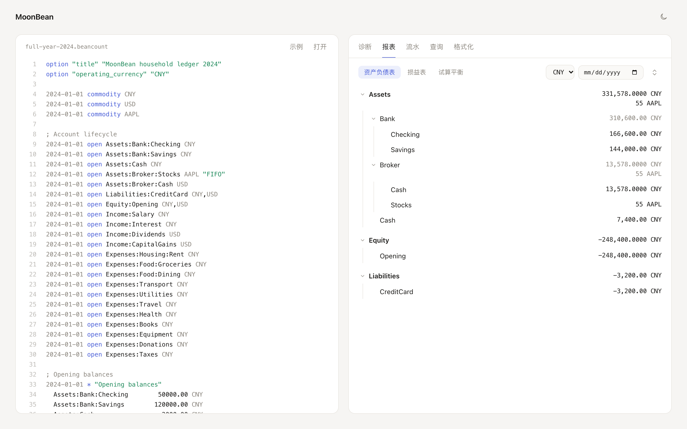

# MoonBean

用 MoonBit 从零写的 Beancount v3 兼容记账引擎：解析、记账（booking）、校验、报表和 BQL 查询都在里面。库本身是纯函数，不碰文件系统，可以在 native、wasm-gc 和 JavaScript 里运行；另带一个 native 命令行工具。

**[在线 Playground](https://sundaysebasidian-byte.github.io/moonbean/)**：在浏览器里粘贴或打开账本，查看诊断、资产负债表、损益表、流水和 BQL 查询结果。账本只在本机浏览器里处理，不会上传。

*English:* MoonBean is a clean-room, Apache-2.0 implementation of a Beancount v3 compatible plain-text accounting engine in MoonBit: parser, exact decimals, lot booking, validation, reports and a BQL subset. The library is pure (no file system), runs on native, wasm-gc and JavaScript, and powers an offline browser playground. It is checked against beancount 3.2.3 as an external black-box oracle.

<picture>
  <source media="(prefers-color-scheme: dark)" srcset="docs/assets/playground-dark.png">
  
</picture>

## 适合谁用

- 用 Beancount 或 Fava 记账的个人和小企业：在已验证范围内比较错误类别、行号和最终余额（见[一致性测试](#一致性测试)和下方迁移边界）。
- 想在应用里内嵌账本能力的 MoonBit 开发者：不需要文件系统和外部进程，`include` 由宿主通过回调提供。
- 需要离线运行的场景：浏览器、wasm 宿主、没有 Python 环境的机器。
- 想读代码学习的人：parser、decimal、booking、BQL 按包拆开，可以单独复用。

## 从 Beancount 迁移

可直接使用的范围是仅依赖已实现指令、booking 方法和下列原生插件（其余账户须显式声明）的纯文本账本，以及本文和 [conformance](docs/conformance.md) 列出的 BQL 子集。120 份自编账本的对比不是对任意 Beancount/Fava 账本的保证；Fava 的界面、扩展、上传附件和 Python 插件运行环境不在本引擎内。迁移前运行 `moonbean check FILE`，并审阅警告和报表。

[迁移示例](examples/migration/) 均为本项目独立编写，确定行为如下：

| 示例 | 行为、位置与原因 |
| --- | --- |
| `plugin.beancount` | `auto_accounts` 自动补齐两个账户的 open，来源指向第 2 行交易；check 退出 0，无插件警告。其他未实现插件仍产生含名称的 `validation.plugin` 警告；依赖它们的生成或校验结果可能不同。 |
| `document.beancount` | 第 2 行 `validation.document_unchecked` 警告；保留附件路径并校验账户，但不检查文件是否存在、内容和访问权限。缺失收据不导致 check 失败；这与 Beancount 文件检查有差异。 |
| `include.beancount` | 第 1 行正常加载同目录的 `document.beancount`（附件警告指向 `document.beancount:2`）；第 2 行找不到文件，`include.missing`，退出 1。native CLI 解析相对路径；库须用 `check_expanded` 提供读取回调，浏览器不会自动读取磁盘。 |
| `cycle.beancount` | 第 1 行 `include.cycle`，退出 1；规范化后的循环路径不会重复加载。 |
| `queries.beancount` | 第 6–8 行分别保存子查询、JOIN、PIVOT。query 指令作为命名文本保留，check 不执行它；显式运行下列查询时均退出 1。 |

```sh
moonbean query examples/migration/queries.beancount 'SELECT account FROM (SELECT account)'
# unsupported query.unsupported.subquery at BQL:1:22
moonbean query examples/migration/queries.beancount 'SELECT account FROM postings JOIN postings'
# unsupported query.unsupported.join at BQL:1:30
moonbean query examples/migration/queries.beancount 'SELECT account PIVOT currency'
# unsupported query.unsupported.pivot at BQL:1:16
```

include 展开保留每行的源文件和行号；诊断指向原始语句，包括多级 include 中的语句。

BQL 位置相对于查询文本（从 1 开始的行与 UTF-16 列），不是保存它的账本行号；库的 `QueryResult.error` 保留上述错误码和位置，`failure()` 返回 `Unsupported`。不支持项须改写为已支持的单一 postings 查询，或继续在外部 beanquery/Fava 执行；不会近似执行子查询、JOIN 或 PIVOT。以上示例由 `python3 scripts/migration_smoke.py` 实测，原始输出见 [迁移证据](docs/evidence/migration.json)。

## Playground

`playground/` 包把引擎编译成一个 JavaScript 模块，`web/` 是纯静态页面（原生 HTML/CSS/JS，没有框架和 CDN）。页面左边是账本编辑器，右边顶部是校验结论和条目、账户计数，下方默认打开资产负债表，其余标签依次是诊断（点击跳转到对应行）、损益表（账户树可折叠，支持多币种和 `operating_currency` 折算）、流水、BQL 查询和格式化预览。资产负债表包含 `Equity:Earnings:*` 结转账户，并标出是否平衡；某个币种找不到折算路径时，报表会标出“折算不完整”和对应账户，合计按币种分开显示。内置示例是 `examples/` 下的全年账本。

本地构建需要 MoonBit 工具链和 node：

```sh
./scripts/build-web.sh                # 产物在 web/dist
python3 -m http.server -d web/dist 8000
node web/smoke.mjs                    # 用示例账本断言导出函数的结果
node web/dom-smoke.mjs                # 无头 Chrome：账本里的恶意字符串不会变成 HTML
```

模块导出 7 个函数，参数和返回值都是 JSON 字符串，错误也以 `{"ok":false,"error":{...}}` 返回，不抛异常：

| 函数 | 请求字段 | 返回 |
| --- | --- | --- |
| `check` | `source` | 是否通过、带行号的错误和警告、账户列表、`operating_currency` |
| `balance_sheet` / `income_statement` / `trial_balance` | `source`、`convert?`、`at?`（损益表另有 `start?`） | 报表行与合计，以及 `complete`、`diagnostics`（折算不完整时给出账户、币种和目标币种）和 `display_precision`；资产负债表另有 `balanced`。不传 `convert` 时按唯一的 `operating_currency` 折算，传 `""` 保留原币 |
| `register` | `source`、`account`、`subtree?`、`at?` | 流水、累计余额和 lot 成本 |
| `query` | `source`、`bql`、`at?` | 列名与结果行 |
| `format` | `source` | 对齐后的文本和是否有变化 |

账本有错误时报表、流水和查询返回 `ledger_invalid`，和命令行的行为一致。浏览器里没有文件系统，所以 `include` 不会被加载，会在对应行给出警告。Playground 包只依赖纯函数包，生成的 JS 里没有 `node:` 导入；压缩前约 1.0 MB，gzip 后约 133 KB。

## 版本对应

| 面 | 对应 | 说明 |
| --- | --- | --- |
| 发布源码 | tag `v0.1.1` | mooncakes 0.1.1 的打包内容与该 tag 指向的提交一致 |
| mooncakes | `sundaysebasidian-byte/moonbean@0.1.1` | 包内容固定，不随 main 变化 |
| Pages | 最近一次推送到 main 的构建 | [`pages.yml`](.github/workflows/pages.yml) 每次 push 到 main 都会重新构建，可能领先于 0.1.1 |

定位发布提交：`git rev-list -n 1 v0.1.1`。下面三条命令分别复现三个面：

```sh
# 源码测试
git checkout v0.1.1
moon test --target all

# 安装包调用：在仓库外新建模块，复制 examples/library_demo 的 main.mbt 和 moon.pkg 到 cmd/main
moon new consumer && cd consumer
moon add sundaysebasidian-byte/moonbean@0.1.1
moon run cmd/main

# 线上引擎：打开 Pages；对应的构建见 Actions 中 Pages 工作流的运行记录
gh run list --workflow pages.yml --limit 1
```

## 安装

在其他 MoonBit 模块里添加依赖：

```sh
moon add sundaysebasidian-byte/moonbean
```

也可以克隆仓库，在根目录开发和运行：

```sh
moon version --all
moon build
```

命令行工具只支持 native（读写文件由 `cmd/main` 负责），库本身所有后端通用。

## 命令行

```sh
# 校验账本，错误输出为 file:line: code: message
moon run cmd/main --target native -- check examples/full-year-2024.beancount

# 试算平衡表，可以指定日期快照和折算币种
moon run cmd/main --target native -- bal examples/full-year-2024.beancount
moon run cmd/main --target native -- bal examples/full-year-2024.beancount --at 2024-06-30 --convert CNY

# 资产负债表、损益表、某个账户的流水、重复交易
moon run cmd/main --target native -- bs examples/full-year-2024.beancount
moon run cmd/main --target native -- is examples/full-year-2024.beancount
moon run cmd/main --target native -- register examples/full-year-2024.beancount Assets:Bank:Checking
moon run cmd/main --target native -- dups examples/full-year-2024.beancount

# BQL 查询，输出文本或 JSON
moon run cmd/main --target native -- query examples/full-year-2024.beancount \
  'SELECT account, sum(units) FROM postings GROUP BY account ORDER BY account'
moon run cmd/main --target native -- query examples/full-year-2024.beancount \
  'SELECT account, sum(units) FROM postings GROUP BY account ORDER BY account' --json

# 格式化（默认打印到标准输出，加 --write 原地写回）
moon run cmd/main --target native -- fmt examples/full-year-2024.beancount

# 导出结构化 JSON
moon run cmd/main --target native -- export examples/full-year-2024.beancount --json
```

`bal`、`bs`、`is` 在只有一个 `operating_currency` 时默认折算成它，`--convert ''` 取消折算。`bs`、`is` 可以用 `--from YYYY-MM-DD --at YYYY-MM-DD` 选择期间（截止日包含当天）；资产负债表默认从截止年份的 1 月 1 日开始，损益表不指定起点时包含全部历史。

`examples/full-year-2024.beancount` 是自己写的 2024 全年家庭账本：多币种、股票 lot、FIFO 卖出、pad 与现金盘点、季度和年末的 balance 断言、价格与自定义指令，MoonBean 和 `bean-check` 都能通过。

不依赖文件系统的库嵌入示例：

```sh
moon run examples/library_demo
```

## 作为库使用

在 `moon.pkg` 里导入根包：

```moonbit
import {
  "sundaysebasidian-byte/moonbean",
}
```

```moonbit
fn analyze(source : String) -> Unit {
  // 纯函数，不访问文件系统；include 由宿主提供 read 回调。
  let ledger = @moonbean.check_source("ledger.beancount", source)
  if ledger.has_errors() {
    for diagnostic in ledger.errors {
      println(@moonbean.diagnostic_text(diagnostic))
    }
    return
  }
  let realized = @moonbean.realize(ledger)
  for position in realized.inventory("Assets:Cash").positions {
    println(position.to_string())
  }
  let result = @moonbean.run_query(
    ledger,
    "SELECT account, sum(units) FROM postings GROUP BY account ORDER BY account",
  )
  println(result.to_text())
}
```

常用入口：

| API | 说明 |
| --- | --- |
| `check_source(file, source)` | 解析并校验，返回 `ValidatedLedger` |
| `check_expanded(file, base_dir, source, read)` | 先展开 `include` 再校验 |
| `expand_includes(source, base_dir, read)` | 返回展开后的源码、缺失路径和带位置的 include 诊断 |
| `realize(ledger, at~)` | 生成 inventory、价格库和账簿快照 |
| `run_query(ledger, bql, at~)` | 执行 BQL 子集 |
| `format_source(source)` | 对齐金额列 |
| `trial_balance`、`balance_sheet`、`income_statement`、`inventory_rows`、`register_rows` | 报表，输出文本或 JSON |
| `@validation.find_duplicate_transactions(entries)` | 查找重复交易 |

## 覆盖范围

“支持”表示有实现也有测试；“部分”表示行为明确但边界更窄；“不支持”表示会明确报错，或记录后跳过，不会悄悄给出错误结果。

### 语法与指令

| 能力 | 状态 | 边界 |
| --- | --- | --- |
| `option` | 部分 | 解析并保留。`title`、`booking_method`、`tolerance_multiplier`、`inferred_tolerance_default`、`infer_tolerance_from_cost` 会影响语义；`account_rounding`、`render_commas` 只解析。只有一个 `operating_currency` 时作为 bal/bs/is 的默认折算币种。报表文本的小数位由 `display_precision` 指定，没有指定时按每个币种最常见的账面小数位推断（并列取较大值）；JSON 保留原精度 |
| `plugin` | 部分 | 按声明顺序原生执行 `auto_accounts`、`implicit_prices`、`check_commodity`、`unique_prices`、`leafonly`（名称前缀 `beancount.plugins.`）；其余只记录并警告，依赖其生成或校验的账本可能不同；配置边界见 [conformance](docs/conformance.md#native-plugins-020) |
| `include` | 支持 | 库和命令行共用同一个展开器：循环 include 报 `include.cycle`，缺失的文件报 `include.missing` 并保留原行，最大嵌套 1024 层 |
| `pushtag` / `poptag` / `pushmeta` / `popmeta` | 支持 | 作用域内的交易继承标签和元数据 |
| `open` | 支持 | 多币种约束、booking method、重复 open 检查 |
| `close` | 支持 | 关闭后的交易检查、未开户就关闭、重复 close |
| `commodity` | 支持 | 解析并记录 |
| `balance` | 支持 | 支持 `~` 显式容差，否则按末位推断；同日断言先于同日交易 |
| `pad` | 支持 | 自动补记；需要补差额且余额含带成本持仓时报错；无差额时仍报 Unused Pad |
| transaction | 支持 | flag、payee/narration、标签、链接、交易和 posting 元数据、posting flag |
| posting 金额表达式 | 支持 | `+ - * /`、括号、一元正负号 |
| cost `{}` / `{{}}` | 支持 | 单价、总价、日期、label；FIFO/LIFO/HIFO/STRICT/STRICT_WITH_SIZE/NONE/AVERAGE |
| `{*}` 合并成本 | 支持 | MoonBean 扩展，beancount 3.2.3 不支持 |
| price `@` / `@@` | 支持 | 单价和总价 |
| 省略金额 | 支持 | 每种币种最多一个自动 posting；无法确定时按 bean-check 的类别报错 |
| `price` / `note` / `event` / `query` / `custom` / `document` | 部分 | 解析、校验账户并保留；`document` 不检查文件是否存在，`query` 不会自动执行 |

### 数值、记账与校验

| 能力 | 状态 | 边界 |
| --- | --- | --- |
| 精确十进制 | 支持 | 自己实现的 decimal，除法和舍入与 Python `decimal` 对齐 |
| 容差推断 | 支持 | 交易容差取最不精确金额的末位乘以 multiplier，再应用 `inferred_tolerance_default`；balance 断言按断言金额的末位推断 |
| booking 方法 | 支持 | STRICT、STRICT_WITH_SIZE、FIFO、LIFO、HIFO、AVERAGE、NONE |
| lot 匹配与错误 | 支持 | 歧义、库存不足、无匹配都带 `booking.*` 错误和位置 |
| 跨 lot 减记 | 支持 | 一次卖出跨多个 lot 时拆成多条 posting，各带自己的成本、日期和 label；BQL、`JOURNAL`、register 和 JSON 导出一致 |
| 交易平衡 | 支持 | 包含 cost、price 和成本分摊的权重 |
| 账户生命周期 | 支持 | 未开户、已关闭、重复 open/close |
| 币种约束 | 支持 | 按 open 声明的币种集合检查 |
| balance 断言 / pad | 支持 | 见上表 |
| 重复检测 | 部分 | open/close/balance 在校验时检查；重复交易用 `dups` 命令或 `find_duplicate_transactions` 按需检查 |

### 报表与 BQL

| 能力 | 状态 | 边界 |
| --- | --- | --- |
| inventory / 价格库 / 市值折算 | 支持 | 按截止日取价，支持逆汇率和多跳折算（确定性路径，带环检测）；找不到路径时报表标记 `complete: false`，返回 `report.conversion_incomplete`，合计按币种分开 |
| 试算平衡 / 资产负债表 / 损益表 / register | 支持 | 资产负债表把当期和往期收益结转到 `Equity:Earnings:*`，恒等式按币种精确成立；不折算时按成本，指定折算币种时按市值，市值相对成本的变化列在 `Equity:Earnings:Unrealized`。命令行有 `bal`、`bs`、`is`、`register FILE ACCOUNT`（可加 `--json`）和 `dups FILE` |
| `SELECT ... FROM postings/balances` | 支持 | 列：`date`、`flag`、`payee`、`narration`、`account`、`root`、`parent`、`leaf`、`units`、`currency`、`cost`、`value`、`position` |
| `FROM transactions` / `FROM #transactions` | 支持公开列 | 每笔交易一行，含 typed meta、tags/links/accounts；posting 列不属于交易表，返回错误。完整语法边界见 compatibility.md |
| `#` 表与星号 | 逐列边界 | 十张 oracle 表的公开列及默认星号均已接入，含 typed dict/directive/id/discrepancy；值域限制见 [compatibility](docs/compatibility.md)。`#balances` 是断言表，裸 `FROM balances` 保留库存扩展。除 `count(*)` 外，函数星号参数拒绝 |
| `WHERE` | 部分 | 比较、`is [not] null`、`and/or/not`，支持 `~` 正则字面量；没有 `LIKE` 和子查询 |
| `HAVING` / 数值算术 | 支持 | `HAVING` 支持聚合条件；Decimal 支持 `+ - * /` 和括号，不含 Amount/Inventory 运算 |
| tags / links / 元数据 | 支持 | `tags`、`links` 的文本按集合字典序排序；JSON 数组保留账本书写顺序（oracle 返回 frozenset，转 JSON 数组的顺序随 hash seed 变化，无稳定顺序契约）；`meta('key')` 按行源读取 posting 或交易元数据，`entry_meta('key')` 读取父交易元数据 |
| `GROUP BY` / `ORDER BY` / `LIMIT` | 支持 | 多键分组和排序，`ASC` / `DESC` |
| 函数 | 逐项边界 | 登记 105 个标量 / 11 个聚合签名的参数类型；74 个标量签名有求值器、31 个未实现。新增金额/库存、元数据、日期、整数/Decimal 转换、round、splitcomp 等。类型和值域例外见[逐项矩阵](docs/compatibility.md)，不声明完整 Python 语义 |
| `BALANCES` / `JOURNAL` | 支持 | `BALANCES AT units|cost FROM OPEN ON date CLOSE ON date`；`JOURNAL <account> [LIMIT n]`；时间点由 `run_query` 的 `at~` 或命令行的 `--at` 控制 |
| 不支持的 BQL | 不支持 | 子查询、`PIVOT BY`（oracle 支持但本引擎未实现）、JOIN、SQL `LIKE`（oracle 也不支持）、其余未实现的函数/语法（见兼容清单）、startswith（oracle 无此签名）、findfirst(str,set)（oracle 支持，本引擎未实现）；BQL 的 `CLOSE ON` 不合成币种转换条目，关闭和结转由报表层处理 |

### 格式化与命令行

| 能力 | 状态 | 边界 |
| --- | --- | --- |
| `moonbean fmt` | 支持 | 对齐 posting 金额列；`--write` 原地写回；roundtrip 测试保证解析结果不变 |
| `check` / `bal` / `query` / `fmt` / `export --json` | 支持 | 退出码 0 表示成功，1 表示失败 |
| js / wasm-gc 库 | 支持 | 根包是纯函数；命令行只支持 native |

## 一致性测试

没有任何 Beancount 代码被复制。测试时把 beancount `3.2.3` 和 beanquery `0.2.0` 当作外部黑盒，对同一份账本比较输出。

**自编账本。** 在 macOS (arm64)、MoonBit `0.1.20261104` 上，对自己写的 120 份账本逐份比较：

```
ledgers: 120, compared: 118, passed: 118, failed: 0, extensions: 2
```

- 118 份可比较的账本全部通过：诊断集合、最终余额、原始 price 条目和固定 BQL 查询一致；插件合成位置的比较规则见 conformance。
- 另外 2 份用到 AVERAGE 和 `{*}`，beancount 3.2.3 不支持，只用本项目自己的测试验证。
- 逐份结果、比较口径和已知差异见 [docs/conformance.md](docs/conformance.md)。

```sh
./scripts/oracle.sh            # 安装固定版本的 oracle 并运行比较
./scripts/oracle.sh --markdown # 重新生成逐份结果表
```

**随机差分。** `scripts/random_differential.py` 对 seed `7` 和 `20261101` 各生成 1000 份账本，覆盖跨三个 lot 的减记、同日多条 posting、币种间的价格路径、七种 booking、pad/balance、容差边界和各类错误。两个 seed 的结果相同：

| 结果 | 数量 | 说明 |
| --- | ---: | --- |
| 与 beancount 完全一致 | 858 | 其中 468 份无错误，比较余额、固定 BQL、posting 行数和成本的金额、日期、label、资产负债表、损益表、报表恒等式和价格路径；390 份是故意写错的账本，只比较诊断 |
| 使用 AVERAGE booking | 142 | beancount 3.2.3 报 `average_unsupported`，MoonBean 实现了 AVERAGE |
| 其他差异 | 0 | |

这 142 份不是错误，而是 MoonBean 的扩展：把 oracle 的 `average_unsupported` 诊断去掉后，两边的诊断集合完全相同。CI 用 `--allow-known-extensions` 校验这一点，出现任何其他差异都会失败。每个 seed 的统计和 AVERAGE 账本编号在 [docs/random-differential.json](docs/random-differential.json)。

`tests/regression/` 还有 22 份专门针对报表、跨 lot 减记和价格路径写的账本，`scripts/report_differential.py` 对它们做逐项检查（既有记录为 25 组场景、144 项；本轮未单独重跑该脚本）。本轮 712 项 BQL 输出/边界/错误类别检查通过，另包含 7196 行 Unicode 语料；其中明确拒绝检查不计为功能实现，详见 [最新验收](docs/evidence/r9-acceptance.md)。这是基于模板的随机测试，不是穷尽的语法 fuzz。

```sh
python3 scripts/random_differential.py --seed 7 --out .oracle-cache/differential/seed-7 --allow-known-extensions
python3 scripts/random_differential.py --seed 20261101 --out .oracle-cache/differential/seed-20261101 --allow-known-extensions
python3 scripts/report_differential.py
python3 scripts/include_smoke.py
python3 scripts/bql_differential.py
python3 scripts/cli_smoke.py
```

oracle 脚本只在临时 virtualenv 里安装 GPL 的 beancount 和 beanquery，不链接、不嵌入、不分发。GitHub [CI](https://github.com/sundaysebasidian-byte/moonbean/actions/runs/41272096814) 已通过，包括 Ubuntu、macOS、Windows、Playground 和 oracle；[Pages](https://github.com/sundaysebasidian-byte/moonbean/actions/runs/41272096811) 已部署。链接所示 Pages 构建的线上资源曾与对应本地构建 SHA-256 核验一致，下载后的引擎 29/29 冒烟检查通过；0.1.1 仅本地验证，尚未部署。

## 性能

Apple M4 / 10 核 / 16 GiB / macOS 27.2，MoonBit 0.1.20261104 release。
离线固定种子 20261101，1 千／1 万／10 万／100 万 source posting，每项预热 2 次、测量 21 次。
以下为首轮基线在 100 万 posting 的库阶段中位数（秒）；不含进程启动、文件 I/O 和文本输出，阶段不可相加：

| 后端 | 解析 | FIFO booking | 校验含 pad | GROUP BY | 进程峰值 RSS |
| --- | ---: | ---: | ---: | ---: | ---: |
| native | 1.931 | 0.505 | 1.017 | 0.812 | 1.55 GiB |
| js | 3.444 | 0.472 | 0.880 | 0.692 | 3.19 GiB |
| wasm-gc | 未完成 | 未完成 | 未完成 | 未完成 | moonrun 堆耗尽 |

wasm-gc 的 100 万 FIFO 综合场景两轮失败，单独复现确认为默认 moonrun 堆上限 OOM；独立 AVERAGE／STRICT booking 和校验场景完成，详见原始记录。

0.2.2 基线的未分组 `ORDER BY` 使用插入排序，10 万／100 万该阶段未完成。
0.2.3 已改为缓存键、保留同值原顺序的 O(n log n) 排序，并通过 native 10 万 posting 的 oracle 逐行差分；比较门限的驱动仍保留历史大排序跳过项，不把它们计为已测性能。
内存为包含输入生成、运行时和所有阶段的进程峰值。
全部原始数组、p50/p95/p99、吞吐、内存和阶段 profile，以及第二轮查询趋势见
R9 在授权的宿主背景负载下测量，按固定三轮采用第三轮后仍有 4 个 JS 百万 FIFO 阶段超限，待空闲复核。[性能证据](docs/performance.md)。历史 CLI 数据与本轮库阶段数据不直接比较。

```sh
export MOON_HOME=/tmp/moon-new PATH=/tmp/moon-new/bin:$PATH
python3 scripts/bench-matrix.py --out .oracle-cache/performance-new
python3 scripts/bench-summary.py .oracle-cache/performance-new
python3 scripts/bench-compare.py .oracle-cache/performance-new
```

比较器读取已提交的 `docs/evidence/performance/baseline/`，同环境下中位数或进程 RSS
增长超过 30%、缺测或环境不匹配即非零退出。30% 是容纳本机计时精度及 GC/JIT／系统噪声的粗粒度报警，
不代表统计显著性；p95/p99 保留观察，不作门禁。CI 不运行此检查。
更新基线前先在空闲机器完整测量并检查比较结果，审核环境、遗漏场景和原始数组后，
仅替换已审阅的 case JSON，再运行 `bench-summary.py docs/evidence/performance/baseline`；
在提交中说明更新原因，保留旧基线的 Git 历史。详细步骤与局限见性能文档。

## 和 mooncakes 上其他项目的区别

MoonBean 不是现有账本库的移植或封装，解析器、decimal、booking、校验、报表和 BQL 都是为本项目写的。和通用的记账、预算库相比，它以 Beancount 账本和 `bean-check` 的行为为兼容目标，并保留 lot、成本、pad 和断言这些复式记账语义。

## 限制与路线图

限制：

- 上述 5 个内置插件原生执行；其他插件只记录并给出警告，不运行 Python。
- `document` 不检查文件是否存在；未实现的 option 不会改变行为。
- BQL 按逐项清单实现：子查询、PIVOT 和 31 个标量签名未实现，JOIN/SQL LIKE 不属于已验证的 oracle 语法；数值算术区分 int/Decimal，不含通用 Amount/Inventory 运算。正则用 MoonBit core 的 Regex 子集，非法或不支持的模式会明确报错并保留位置。BQL 字符串的反斜杠和重复引号与 oracle 一样保留原字符，不按 Python 或 C 转义解码。
- Playground 一次只处理一段文本，不加载 `include`。

路线图：

1. 插件扩展点（宿主可以注册自定义校验和变换）。
2. 更完整的 BQL（完整对象运算、子查询、PIVOT、金额运算、期间转换的归一化）；LIKE/JOIN 不属于 beanquery 0.2.0 的已验证语法。
3. `account_rounding` 的输出语义。
4. 更大账本的增量 realize 和缓存。

## 许可证与合规

MoonBean 以 **Apache-2.0** 发布，见 [LICENSE](LICENSE)。

Beancount 和 beanquery 是 GPL-2.0，本项目是净室实现：

- 不复制它们的源码、注释或测试数据，规范依据只有公开文档（Language Syntax、How Inventories Work、BQL、Precision & Tolerances）。
- `tests/ledgers/` 和 `examples/` 下的账本都是自己写的。
- Beancount 只在一致性测试里作为外部黑盒：固定版本、装进临时 virtualenv、运行后比较输出。
- Playground 的页面、样式和脚本也都是自己写的，没有使用 Beancount 或 Fava 的任何代码、样式或资源。
- 详见 [NOTICE](NOTICE)。

## 开发

```sh
moon check --deny-warn --target all
moon test --target all
moon fmt --check
moon info && git diff --exit-code
./scripts/build-web.sh && node web/smoke.mjs && node web/dom-smoke.mjs
```

`moon test --target all` 覆盖 wasm、wasm-gc、js、native 四个后端，每个后端 132 个测试。`web/dom-smoke.mjs` 需要本机装有 Chrome（可用环境变量 `CHROME` 指定路径）。CI 在 ubuntu、macOS、Windows 上运行同一组命令，另有 playground 和 oracle 两个 job。

## 0.2.3 compatibility boundary

The endpoint is beancount 3.2.3 plus beanquery 0.2.0 in full; this candidate has not reached it. [The compatibility matrix](docs/compatibility.md) lists every advertised table/column, function signature and option, with evidence, reasons, impact and alternatives for remaining gaps. All ten source schemas now have typed columns, including dict/directive/id/discrepancy values and tagged notes. Position DISTINCT preserves representation differences and uses hash lookup. Source-resolved signatures distinguish int/decimal and set/frozenset; 74 scalar signatures have evaluators, while 31 remain unimplemented. A registered signature is not proof of full value-domain equivalence.

Signed-zero sources reject exact object/fingerprint queries; nonfinite Decimal conversions and hash-seed-dependent multi-member set repr are explicit boundaries. Subqueries, PIVOT, FROM OPEN/CLOSE/CLEAR combinations, PRINT, shell .explain/.run, rounding accounts, document callbacks and oracle presentation remain gaps. LIKE/JOIN and the tested FLATTEN/EXPLAIN keyword forms are rejected by the pinned oracle too. [Current local acceptance](docs/evidence/r9-acceptance.md) separates positive comparisons from rejection checks. No full compatibility, new remote CI run or release publication is claimed.
